<p align="center">
  
</p>

<h1 align="center">Xtreme Download Manager</h1>

<p align="center">
  <b>Fast, resumable downloads and one-click video grabbing — right from your browser.</b>
</p>

<p align="center">
  <a href="https://github.com/subhra74/xdm/releases"></a>
  <a href="https://github.com/subhra74/xdm/releases/latest"></a>
  
  
</p>

<p align="center">
  <a href="https://xtremedownloadmanager.com/">Homepage</a> ·
  <a href="https://xtremedownloadmanager.com/#downloads">Download</a> ·
  <a href="#-features">Features</a> ·
  <a href="#-browser-integration">Browser integration</a> ·
  <a href="#-building-from-source">Build</a> ·
  <a href="#-translations">Translations</a> ·
  <a href="https://www.reddit.com/r/xtremedownloadmanager/">Reddit</a> ·
  <a href="CODE_SIGNING_POLICY.md">Code signing policy</a>
</p>

<p align="center">
  <a href="https://xtremedownloadmanager.com/#downloads"></a>
</p>

<p align="center">
  <!-- <a href="https://www.youtube.com/watch?v=qrUUSFh3Xfg">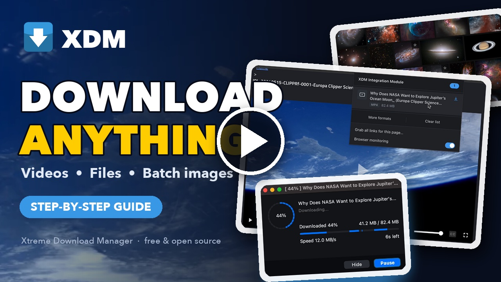</a>
  &nbsp; -->
  <a href="https://www.youtube.com/watch?v=WS0WH1BZ9xo">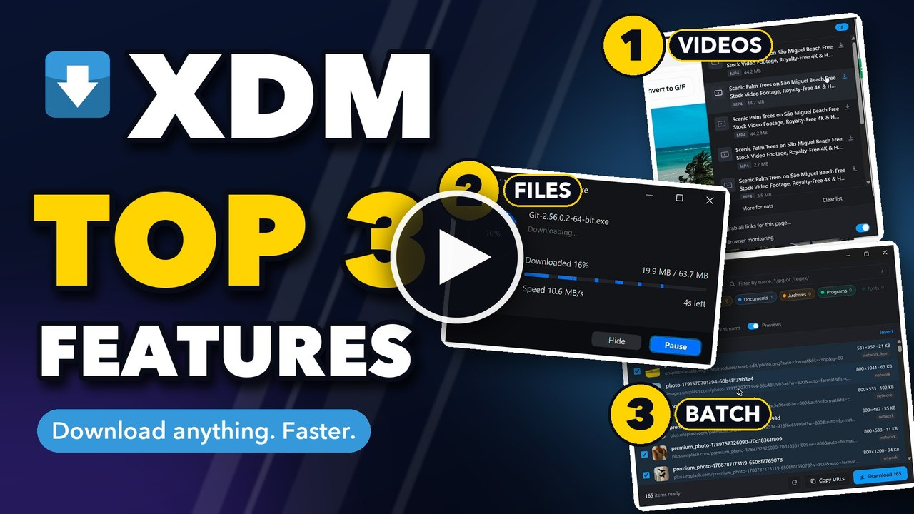</a>
  <!-- &nbsp;
  <a href="https://www.youtube.com/watch?v=IJIxP7imtZ8">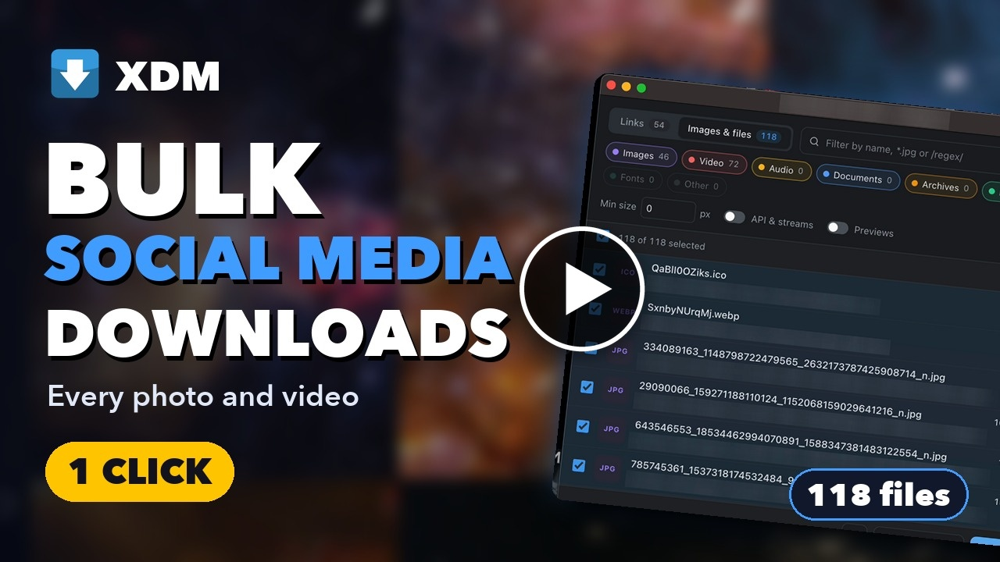</a> -->
  <br/>
  <sub>
  <!-- <b>Quick start guide</b> &nbsp;·&nbsp;  -->
  <b>Top 3 features</b> 
  <!-- &nbsp;·&nbsp;  -->
  <!-- <b>Bulk social media downloads</b> -->
  </sub>
</p>

---

**Xtreme Download Manager (XDM)** speeds up downloads by splitting them across multiple connections, saves videos
from streaming sites, and picks up broken downloads exactly where they left off. A companion browser extension hands
downloads and detected videos straight to the app, so you never have to copy a link by hand.

Wondering why you'd still want a download manager on a fast connection? Read
[Why use a download manager in an age of fast internet?](docs/why-a-download-manager.md)

> [!NOTE]
> As of 2026 XDM is being rebuilt and is in **active development**.

> [!WARNING]
> **A note for contributors:** XDM is going through a major rewrite, and the code is being restructured often.
> Pull requests made now may need a lot of rework, or no longer apply after the next round of changes. Please hold off
> on code contributions until things settle down. Translations, bug reports and feature ideas are very welcome in the
> meantime. Thank you for your patience and support!

## 📸 Screenshots

| Main window | New download |
|:---:|:---:|
| 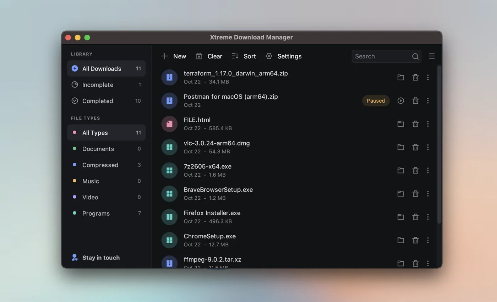 | 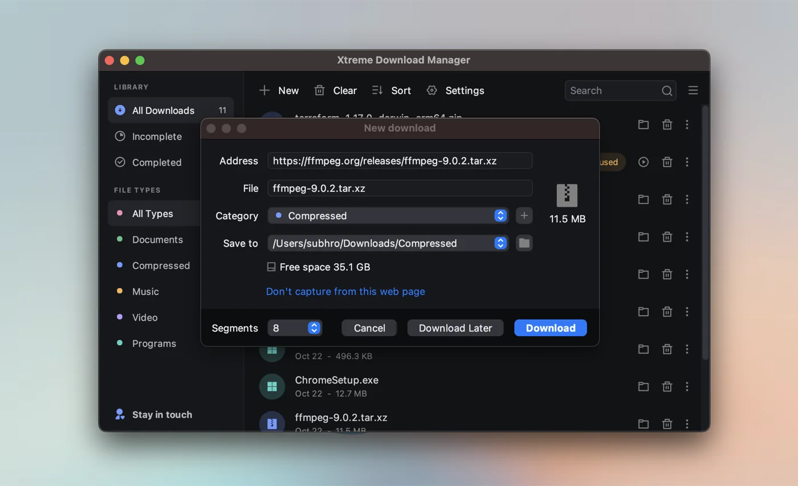 |
| **Download progress** | **Download complete** |
| 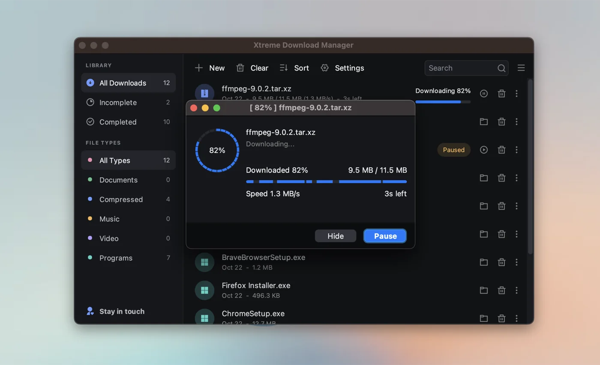 | 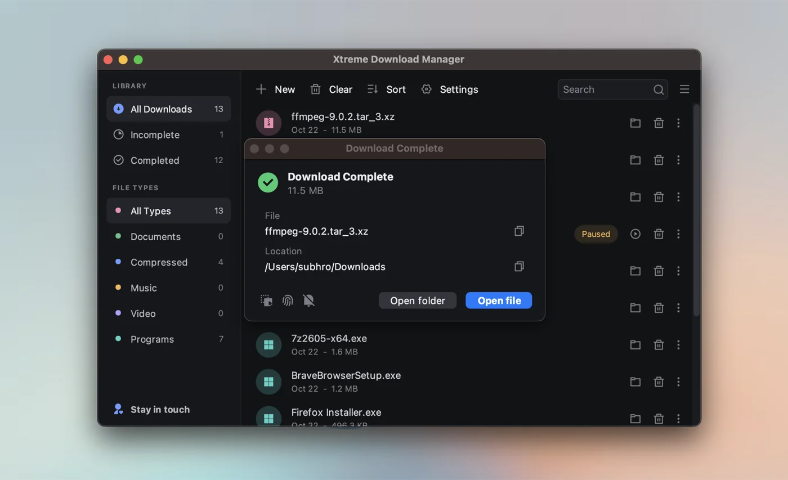 |
| **Videos detected by the extension** | **Video download** |
| 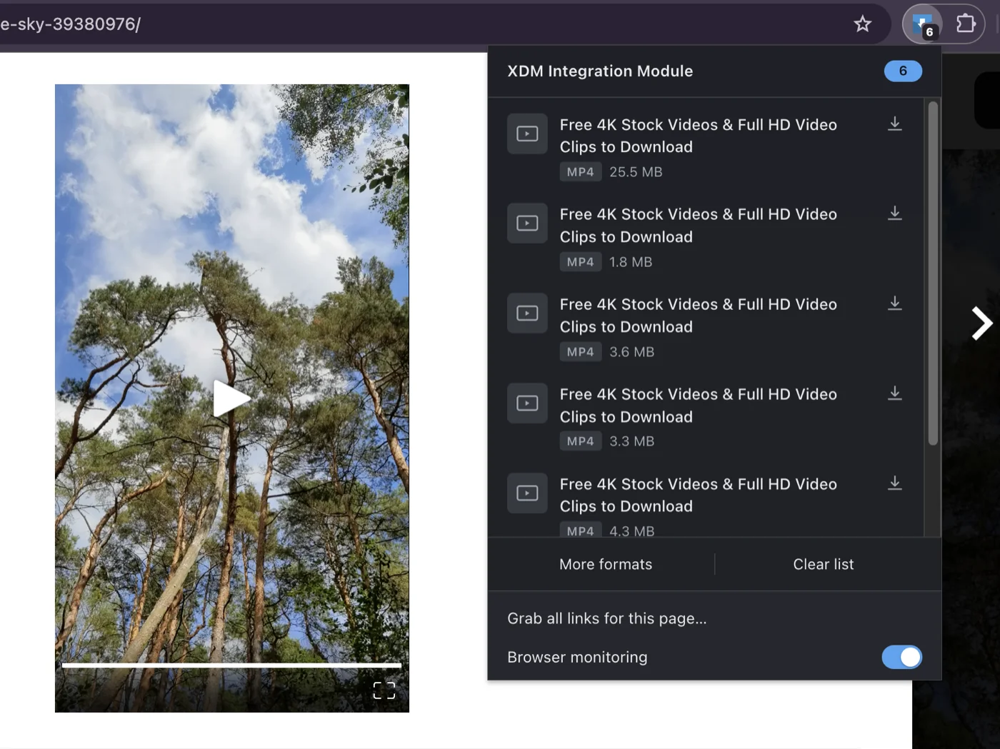 | 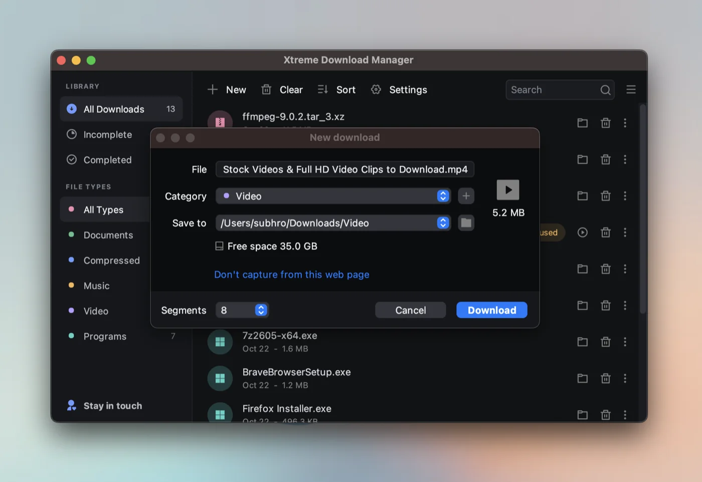 |
| **Download all links on a page** | **Pick what to grab** |
| 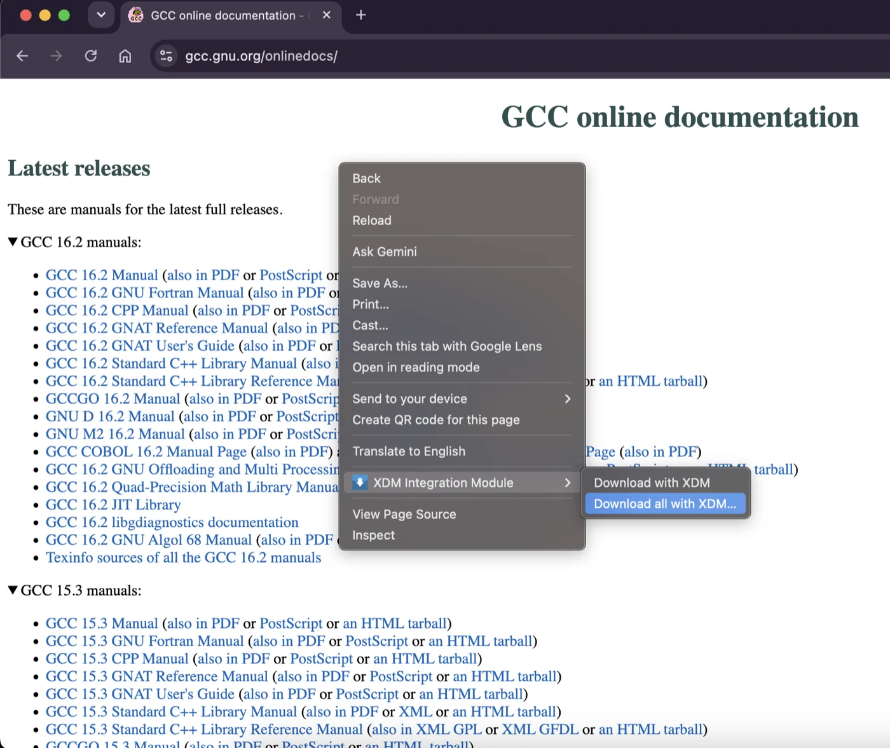 | 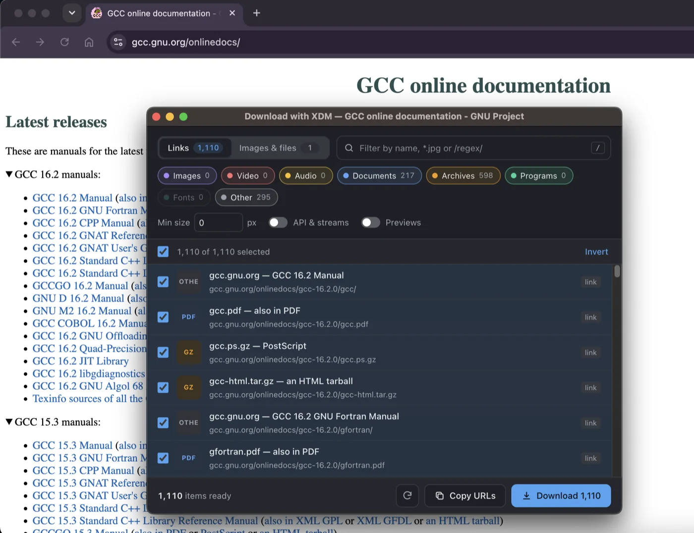 |
| **Batch download** | **HLS / DASH stream download** |
| 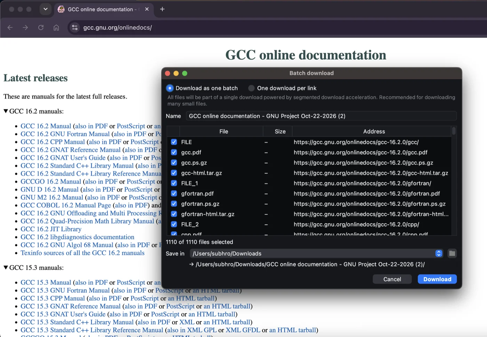 | 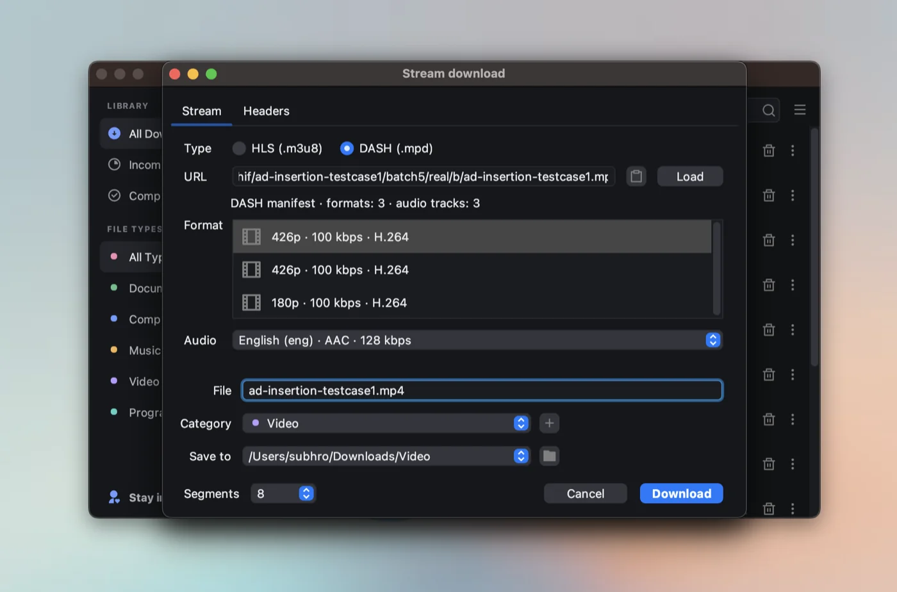 |

## 🆕 What's new in XDM 9

XDM 9 is a ground-up rewrite. Highlights:

- **Writes straight to the final file:** HTTP downloads go directly into your download folder, with no temp copy
  and no slow "assembling" step at the end. Large files finish the moment the last byte arrives.
- **Better HLS and DASH:** more reliable stream detection, a choice of quality and audio track, and muxing to MP4
  without ffmpeg. You can also grab subtitles as `.srt`, timed to match the video.
- **Bulk downloads:** right-click → *Download all with XDM* to grab every PDF, image or video on a page. You can
  also save a social media profile's videos and images in one go, with video and audio merged into
  ready-to-play MP4s.
- **On the Chrome Web Store:** install the browser extension with one click.
- **Modern UI:** a refreshed light and dark theme, runs natively on Wayland, a native macOS build
  (Apple Silicon and Intel) and Windows on ARM64 support.
- **Command-line mode:** `xdm-app --headless -o <folder> <url>` downloads HTTP, HLS and DASH from a terminal, with
  a quality pick (`-q best|720p|audio`). It can run alongside the app.
- **Download categories:** rules sort each download into a category and folder. You can change the folder or
  restart a download from the list.
- **Disk errors never restart from zero:** a full disk or a missing folder stops the download and keeps its
  progress.
- **Checksum verification:** check a finished file's hash from the download-complete window or the download's
  properties.
- **Safer downloads:** finished files are marked as coming from the internet (Mark-of-the-Web on Windows,
  quarantine on macOS), so SmartScreen and Gatekeeper still check them. You can turn this off in settings.
- **NTLM authentication:** works with Windows/IIS servers and corporate proxies that require NTLM.

## ✨ Features

| | |
|---|---|
| ⚡ **Faster downloads** | Multi-connection segmented downloading to make the most of your bandwidth. |
| 🧩 **Browser integration** | Works with Chrome, Firefox, Edge and other popular browsers: XDM takes over downloads from the browser automatically, so every file gets the speed boost without copying a link. |
| 🎬 **Video grabber** | Detects and saves videos from streaming sites, including `HLS` (`.m3u8`) and `MPEG-DASH` (`.mpd`) streams, muxed to MP4 with no external tools. Pick a subtitle track and get it as an `.srt` file, timed to match the video. |
| 🔁 **Resume anything** | Recovers downloads interrupted by network drops, crashes or power loss; refresh expired links without starting over. |
| 📱 **Bulk social media downloads** | Save every video and image from a social media profile in a single click. Video and audio tracks are merged into ready-to-play MP4s, and ads are left out. |
| 📦 **Batch downloads** | Grab every PDF on a page or a whole gallery of HD wallpapers at once: right-click → *Download all with XDM*, filter by type, size or name, and save them all into a single folder. |
| 🗓️ **Scheduler & queues** | Start and stop downloads on a schedule, limit parallel downloads, shut down when done. |
| 📋 **Paste from clipboard** | Add one link or a whole list of links straight from the clipboard. |
| 🌐 **Proxies & auth** | HTTP and SOCKS proxies, and server/proxy authentication. |
| 🛡️ **Antivirus scan** | Optionally scan finished downloads with your antivirus. |
| 🖥️ **Cross-platform** | Native-feeling app on Windows, macOS and Linux, with light and dark themes. |

## 🧩 Browser integration

XDM works with Chrome, Firefox, Edge, Opera, Vivaldi, Brave and other Chromium- and Firefox-based browsers.

| Browser | Extension |
|---|---|
|  | [Install XDM for Chrome](https://xtremedownloadmanager.com/extension/chrome/?utm_source=xdm-app) |
|  | [Install XDM for Firefox](https://xtremedownloadmanager.com/extension/firefox/?utm_source=xdm-app) |

The extension forwards downloads and detected media to the running app over a local-only connection
(`127.0.0.1:8597`); nothing leaves your machine.

## 🛠️ Building from source

**Requirements:** JDK 25 (configured as a [Maven toolchain](packaging/toolchains.sample.xml)) and Maven.

```bash
# 1. Point Maven at your JDK 25
cp packaging/toolchains.sample.xml ~/.m2/toolchains.xml   # then edit jdkHome

# 2. Build the app (fat jar: xdm-app/target/xdm-app.jar)
mvn -q -pl xdm-app -am package

# 3. Run it
java -jar xdm-app/target/xdm-app.jar
```

| Module | What it is |
|---|---|
| `xdm-core` | Download engine (HTTP, HLS, DASH, batch), no UI dependencies, JDK 8 compatible |
| `xdm-app` | Swing desktop app (FlatLaf) and browser-integration server |
| `browser-extension` | Chrome and Firefox extensions |

**Contributing?** Commits need a DCO sign-off (see [CONTRIBUTING.md](CONTRIBUTING.md)). Install the hook that adds
it for you, once per clone. It signs with the `user.name` and `user.email` from your git config, and works with
GitHub Desktop and other tools that have no sign-off option:

```bash
# macOS / Linux
cp .githooks/prepare-commit-msg .git/hooks/ && chmod +x .git/hooks/prepare-commit-msg
```

```bat
:: Windows (Command Prompt)
copy .githooks\prepare-commit-msg .git\hooks\
```

## 💬 Community & support

Questions, tips or need help? Join the XDM community on Reddit:
[r/xtremedownloadmanager](https://www.reddit.com/r/xtremedownloadmanager/). Bug reports and feature requests are welcome
on [GitHub Issues](https://github.com/subhra74/xdm/issues).

## 🌍 Translations

Want XDM in your language? Translations are welcome. Translate in the browser on
[Weblate](https://hosted.weblate.org/projects/xdm/), and preview your work in XDM before it ships. See
[TRANSLATING.md](TRANSLATING.md).

## 🗑️ Uninstalling

- **Windows:** Settings → Apps → Installed apps → *Xtreme Download Manager* → Uninstall.
- **macOS:** quit XDM, then drag `xdm-app` from Applications to the Trash.
- **Linux:** `sudo apt remove xdm-app` (Debian/Ubuntu), `sudo dnf remove xdm-app` (Fedora) or
  `sudo pacman -R xdm-app` (Arch).

Uninstalling keeps your settings and download list. To remove them too, delete the data folder:
`%LOCALAPPDATA%\xdm-app` (Windows), `~/Library/Application Support/xdm-app` (macOS) or
`~/.local/share/xdm-app` (Linux).

## 🔏 Code signing policy

Free code signing provided by [SignPath.io](https://about.signpath.io), certificate by [SignPath Foundation](https://signpath.org).
Who builds, reviews and approves signed releases: see the [code signing policy](CODE_SIGNING_POLICY.md).

## 🔒 Privacy

XDM has no accounts, analytics or tracking, and keeps your data on your computer. See the [privacy policy](PRIVACY.md).

## 📄 License

XDM is free software, licensed under the [GNU General Public License v3.0](LICENSE). XDM 8 and earlier were released
under GPL v2.

The download engine, [`xdm-core`](xdm-core), is licensed separately under the
[Apache License 2.0](xdm-core/LICENSE), so it can be reused in other projects, including closed-source ones, as long
as its [NOTICE](xdm-core/NOTICE) is kept and the product credits it. Everything else in this repository, including the
desktop app (`xdm-app`) and the browser extensions, stays under GPL v3.

## ⭐ Star history

<a href="https://star-history.com/#subhra74/xdm&Date">
  <picture>
    <source media="(prefers-color-scheme: dark)" srcset="https://api.star-history.com/svg?repos=subhra74/xdm&type=Date&theme=dark" />
    <source media="(prefers-color-scheme: light)" srcset="https://api.star-history.com/svg?repos=subhra74/xdm&type=Date" />
    
  </picture>
</a>

## ⚖️ Disclaimer

XDM is a general-purpose download manager intended for lawful use only.

- XDM does not support downloading from YouTube.
- XDM does not support DRM-protected content and does not circumvent DRM or any other technical protection measure.
- Use XDM only to download content that you own or are authorized to download, in compliance with applicable laws
  and the terms of service of the websites you use.
- The XDM authors and contributors do not endorse, encourage, or condone copyright infringement or any other unlawful
  use of this software.
- XDM is provided "as is", without warranty of any kind, as set out in its [license](LICENSE). The authors and
  contributors are not responsible or liable for how users use the software, or for any loss or damage arising from
  its use.
- XDM is not affiliated with, endorsed by, or sponsored by YouTube, Google, or any other website or service it may be
  used with. All trademarks belong to their respective owners.

---

<p align="center">
  Made with ☕ by <a href="https://github.com/subhra74">subhra74</a> and contributors ·
  <a href="https://xtremedownloadmanager.com/">xtremedownloadmanager.com</a>
</p>
